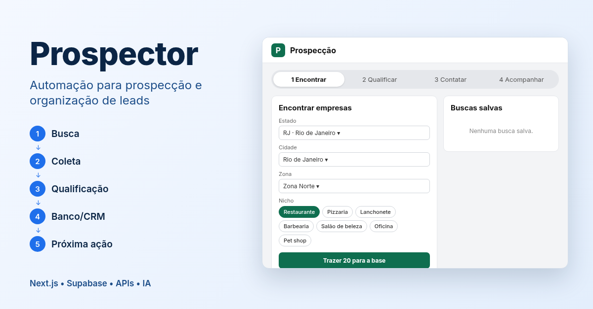

# Automação para prospecção e organização de leads

**Next.js • Supabase • APIs • IA**



Sistema web para encontrar empresas locais, qualificar cada uma e organizar todo o funil comercial (encontrar → qualificar → contatar → acompanhar) num painel único.

## O que faz
- **Busca de empresas** por região e segmento a partir de dados abertos (OpenStreetMap/Overpass e base pública de CNPJ).
- **Qualificação por regras** (pontuação, canal de contato ideal, validação de telefone e nono dígito), funcionando **sem IA**; IA é opcional.
- **Rascunhos de abordagem** por canal (WhatsApp, e-mail, ligação), com rodapé de opt-out e fluxo de LGPD.
- **Funil e acompanhamento**: retornos do dia, propostas, histórico e controle de equipe.

## Stack
- **Front:** Next.js (App Router), TypeScript, Tailwind CSS
- **Back:** Supabase (Postgres, RLS, Auth, Edge Functions em Deno)
- **Integrações:** APIs públicas de dados abertos; provedores de LLM opcionais

## Estrutura
```
painel/              # app Next.js
supabase/functions/  # Edge Functions (regras, ingestão, dashboard)
supabase/migrations/ # schema do banco, versionado
```

## Rodando localmente
```bash
cd painel
cp .env.example .env.local   # preencha com o seu projeto Supabase
npm install
npm run dev
```
Aplique as migrations com `supabase db push` num projeto Supabase seu.

---
Feito por [Estevam Juliano](https://www.linkedin.com/in/estevamjuliano).
